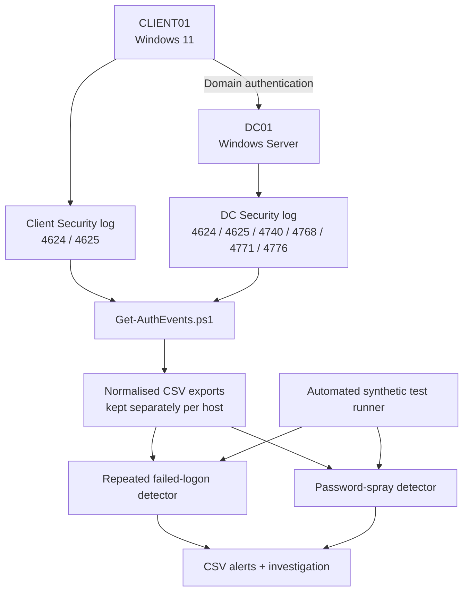

# Active Directory Authentication Monitoring & Detection Lab

A practical Windows security monitoring project built around a small Active Directory lab. The project collects Windows Security authentication events, normalises them into CSV, applies two explainable detection rules, and validates the rules with repeatable synthetic tests.

## Objectives

- Build and administer a Windows Server Active Directory domain and a domain-joined Windows endpoint.
- Configure and verify Advanced Audit Policy settings.
- Collect Windows Security events from the endpoint and domain controller.
- Parse relevant authentication fields into a consistent CSV schema.
- Detect repeated failed logons against one account.
- Detect password-spray-like failures across multiple accounts from one source IP.
- Validate detection behaviour with deterministic, synthetic test cases.
- Document investigation findings, assumptions, false-positive considerations and limitations.

## Lab architecture



The endpoint and domain-controller exports should initially remain separate. The same authentication activity can be represented by different event records on different machines; blindly concatenating both exports can double-count related activity.

## Environment

Document your actual values before publishing:

| Component | Example / lab value |
|---|---|
| Domain | `lab.local` |
| Domain controller | `DC01` |
| Endpoint | `CLIENT01` |
| DC address | `192.168.183.10` (verify in your lab) |
| Client address | `192.168.183.130` (verify in your lab) |
| Virtual network | VMware VMnet8 NAT |
| Server OS | Windows Server 2025 |
| Client OS | Windows 11 Enterprise Evaluation |
| Scripting | Windows PowerShell 5.1 or PowerShell 7 on Windows |

Do not publish real passwords, private IP details you do not wish to disclose, account identifiers, raw event logs, hostnames from your personal environment, or unredacted screenshots. Replace this table with sanitised values if needed.

## Repository layout

```text
AD-Authentication-Monitoring-Lab/
├── README.md
├── LICENSE
├── .gitignore
├── scripts/
│   ├── Get-AuthEvents.ps1
│   ├── Export-AuditPolicySnapshot.ps1
│   ├── Detection.Common.ps1
│   ├── Detect-RepeatedFailedLogons.ps1
│   └── Detect-PasswordSpray.ps1
├── tests/
│   └── Invoke-DetectionTests.ps1
├── docs/
│   ├── architecture.md
│   ├── detection-logic.md
│   ├── investigation-template.md
│   ├── runbook.md
│   └── release-checklist.md
├── sample-data/
│   └── README.md
└── evidence/
    └── screenshots/
```

Runtime exports are written to an `output/` directory and are excluded from Git by `.gitignore`.

## Requirements

- Windows Server / Windows client with a Security event log.
- PowerShell 5.1 or later on Windows.
- Administrator rights to read the Security log and to change audit policy.
- Audit policies enabled for the event types you intend to collect.

## 1. Configure auditing

Use Advanced Audit Policy Configuration through Group Policy for a persistent domain configuration. At minimum, review:

- **Logon/Logoff → Audit Logon:** Success and Failure.
- **Account Logon → Audit Credential Validation:** Success and Failure where NTLM credential validation is in scope.
- **Account Logon → Audit Kerberos Authentication Service:** Success and Failure on domain controllers where Kerberos TGT activity is in scope.

Apply policy and verify the effective result with:

```powershell
auditpol /get /category:*
```

Do not assume an event is missing because an attack did not happen until you have checked the relevant audit subcategory, time range, event source and event retention.

## 2. Collect events

Copy the `scripts/` directory to each VM or run the collector from a location accessible to that VM. Run PowerShell elevated.

On **CLIENT01**, collect endpoint logon events:

```powershell
.\Get-AuthEvents.ps1 `
  -DaysBack 7 `
  -EventIds 4624,4625 `
  -OutputPath 'C:\Users\Public\Documents\Cyberlab\Client-Auth-Events.csv'
```

On **DC01**, collect domain authentication and lockout events:

```powershell
.\Get-AuthEvents.ps1 `
  -DaysBack 7 `
  -EventIds 4624,4625,4740,4768,4771,4772,4776,4777 `
  -OutputPath 'C:\Users\Public\Documents\Cyberlab\DC-Auth-Events.csv'
```

The collector writes a standard CSV containing the time, source computer, event ID, account, logon type, workstation, source IP, status codes and selected event data. A `-MaxEvents` cap is provided to avoid unexpectedly large exports; if the cap is reached, the script warns that the results may be truncated.

To export the effective audit policy on each VM:

```powershell
.\Export-AuditPolicySnapshot.ps1 -OutputPath 'C:\Users\Public\Documents\Cyberlab\AuditPolicySnapshot.txt'
```

## 3. Run detections

Copy the relevant CSV to a working `output/` folder beside the repository, or specify an explicit input and output path. Keep client and DC files separate during initial analysis.

Repeated failures against one account:

```powershell
.\scripts\Detect-RepeatedFailedLogons.ps1 `
  -InputPath '.\output\DC-Auth-Events.csv' `
  -OutputPath '.\output\Repeated-Failed-Logon-Alerts.csv' `
  -Threshold 2 `
  -WindowMinutes 5 `
  -EventIds 4625
```

Password-spray-like activity from one source IP:

```powershell
.\scripts\Detect-PasswordSpray.ps1 `
  -InputPath '.\output\DC-Auth-Events.csv' `
  -OutputPath '.\output\Password-Spray-Alerts.csv' `
  -AccountThreshold 5 `
  -WindowMinutes 10 `
  -EventIds 4771,4772
```

The repeated-failure detector groups by account and event ID so a 4625 record and a 4776 record are not automatically counted as two attempts. Use `-EventIds` to scope analysis to one event type or protocol. It forms event clusters where consecutive failed events are no more than the configured window apart, then calculates the **maximum number of failures in any actual sliding window**. This prevents a chained cluster spanning a longer period from being incorrectly described as though every event fell inside one window.

The password-spray detector groups by normalised source IP and looks for a threshold number of **distinct accounts** within a sliding time window. IPv4-mapped IPv6 addresses are normalised where .NET can parse them.

An alert is a lead for investigation, not proof of compromise. Consider source address, workstation, event ID, authentication package, status/substatus, account type, expected user activity and nearby successful events.

## 4. Run automated tests

From the repository root, run:

```powershell
.\tests\Invoke-DetectionTests.ps1
```

The test runner generates synthetic CSV inputs in `tests/results/`, executes both detectors and checks the output against expected alert counts and peak values. The tests cover:

- Single failure and repeated failures.
- Events outside the time window and exactly on the boundary.
- Separate and overlapping clusters.
- Different accounts.
- DC-side Kerberos and NTLM failure event IDs.
- Password-spray thresholds, multiple source IPs, repeated attempts against one account, IPv4-mapped IPv6 and missing source IPs.

The generated test output is intentionally ignored by Git. If you wish to publish a test summary, copy a reviewed, synthetic-only summary to `docs/` after running it and recording the actual result.

## Event ID quick reference

| Event ID | Summary | Typical relevance |
|---|---|---|
| 4624 | Successful logon | Endpoint / resource logon success; inspect Logon Type |
| 4625 | Failed logon | Failed logon on the computer where it was recorded |
| 4740 | User account locked out | Account lockout investigation |
| 4768 | Kerberos TGT requested | Kerberos authentication service; inspect status |
| 4771 | Kerberos pre-authentication failed | Failed Kerberos pre-authentication on a domain controller |
| 4772 | Kerberos TGT request failed | Failed Kerberos authentication ticket request |
| 4776 | NTLM credential validation | Credential validation on the authority for the account; DC for domain accounts |
| 4777 | Domain controller failed to validate credentials | NTLM credential-validation failure event |

Event meaning and field availability vary by event version and Windows configuration. Consult the Microsoft event documentation linked below.

## Known limitations

- This is a lab-scale PowerShell project, not a SIEM or production monitoring platform.
- The scripts read local exported CSV data; they do not provide continuous or centralised collection.
- Some authentication events do not contain a source IP. Those events cannot contribute to the IP-based password-spray rule.
- The password-spray rule is a heuristic. NAT, proxies, shared jump hosts, service accounts and legitimate bulk activity can create noisy results.
- Windows event retention, audit policy and filtering determine what data is available.
- The detector does not prove intent or compromise and should not automatically disable or lock accounts.
- Real-world deployment would require stronger handling of event forwarding, deduplication, clock synchronisation, access controls, alert prioritisation and monitoring health.

## References

- [Microsoft: Advanced Audit Policy Configuration](https://learn.microsoft.com/en-us/windows-server/identity/ad-ds/plan/security-best-practices/advanced-audit-policy-configuration)
- [Microsoft: Event 4776](https://learn.microsoft.com/en-us/previous-versions/windows/it-pro/windows-10/security/threat-protection/auditing/event-4776)
- [Microsoft: Active Directory events to monitor](https://learn.microsoft.com/en-us/windows-server/identity/ad-ds/plan/appendix-l--events-to-monitor)
- [GitHub: Push protection](https://docs.github.com/en/code-security/how-tos/secure-your-secrets/prevent-future-leaks/enable-push-protection)

## Author / project notes

Add your name or GitHub handle, the date you completed your lab, your actual test results and a small number of sanitised screenshots before making the repository public.
